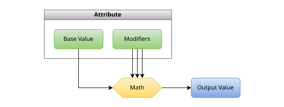
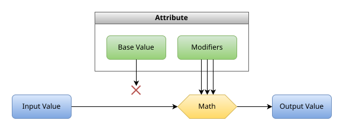

# Dynamic Attribute

Most attributes added by the mod work different from vanilla attributes. Instead of providing a value they modify dynamic values. They are calculated like other attributes, but their base value is internally set to the dynamic value which is only known when a certain event happens.

For example in case of `puffish_attributes:resistance` attribute, when the player takes damage, the base value is internally set to the amount of damage taken, then modifiers of that attribute are applied, and the result is the new damage amount.

Changing base value of these attributes is not possible, and it is always displayed as [NaN](https://en.wikipedia.org/wiki/NaN). It is not due to a bug, but to indicate that it is a dynamic attribute and the base value should not be used.

## Comparison

Vanilla attributes can always provide an output value, which is calculated from a base value and modifiers.

{width=100%}

Dynamic attributes require an input value, which is used in place of a base value, the rest is calculated exactly the same.

{width=100%}

## Examples

::: details Click to view
Assume the player originally deals `8` damage and has the following modifiers of the `puffish_attributes:melee_damage` attribute which has positive effect.
- `1` and `2` both `addition` then deals `8 + 1 + 2 = 11` damage.
- `0.25` and `0.3` both `multiply_base` then deals `8 * (1 + 0.25 + 0.3) = 12.4` damage.
- `0.25` and `0.3` both `multiply_total` then deals `8 * (1 + 0.25) * (1 + 0.3) = 13` damage.
- Three `0.5` all `multiply_base` then deals `8 * (1 + 0.5 + 0.5 + 0.5) = 20` damage.
- Three `0.5` all `multiply_total` then deals `8 * (1 + 0.5) * (1 + 0.5) * (1 + 0.5) = 27` damage.
:::

::: details Click to view
Assume the player originally takes `8` damage and has the following modifiers of the `puffish_attributes:resistance` attribute which has negative effect.
- `1` and `2` both `addition` then takes `8 - 1 - 2 = 5` damage.
- `0.25` and `0.3` both `multiply_base` then takes `8 * (1 - 0.25 - 0.3) = 3.6` damage.
- `0.25` and `0.3` both `multiply_total` then takes `8 * (1 - 0.25) * (1 - 0.3) = 4.2` damage.
:::

## Advanced topics

One may notice that since dynamic attributes do not use base value, they should not be attributes, because in theory they violate [Liskov substitution principle](https://en.wikipedia.org/wiki/Liskov_substitution_principle). In practice however, there are significant benefits. Attributes are built feature in the game, and a lot of mods can already interact with them. Dynamic attributes being attributes enables them to be used by these mods as well. The lack of base value is not a problem, because modifiers are always used instead, in this case. The reason is that the base value is global, and if two mods changed it, they would overwrite the value for each other.